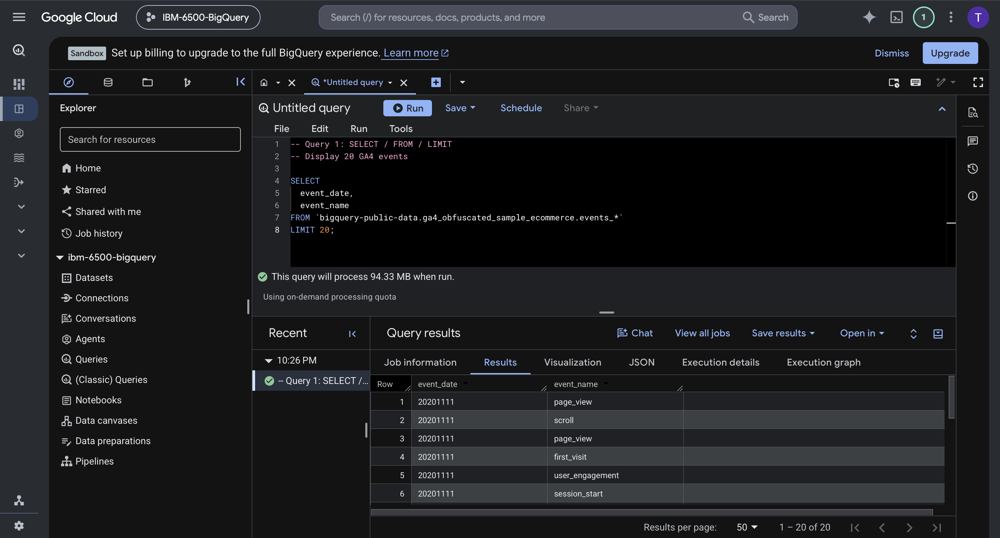
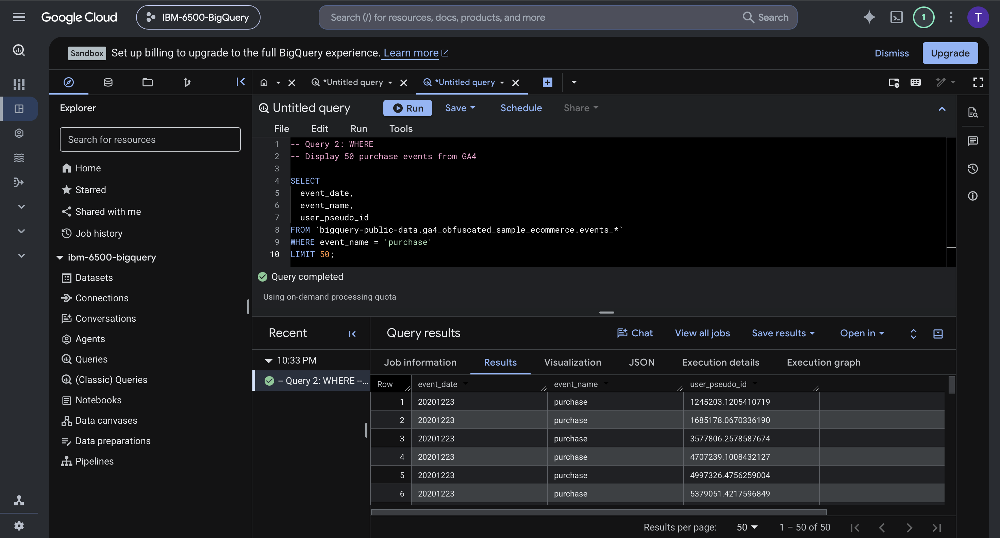
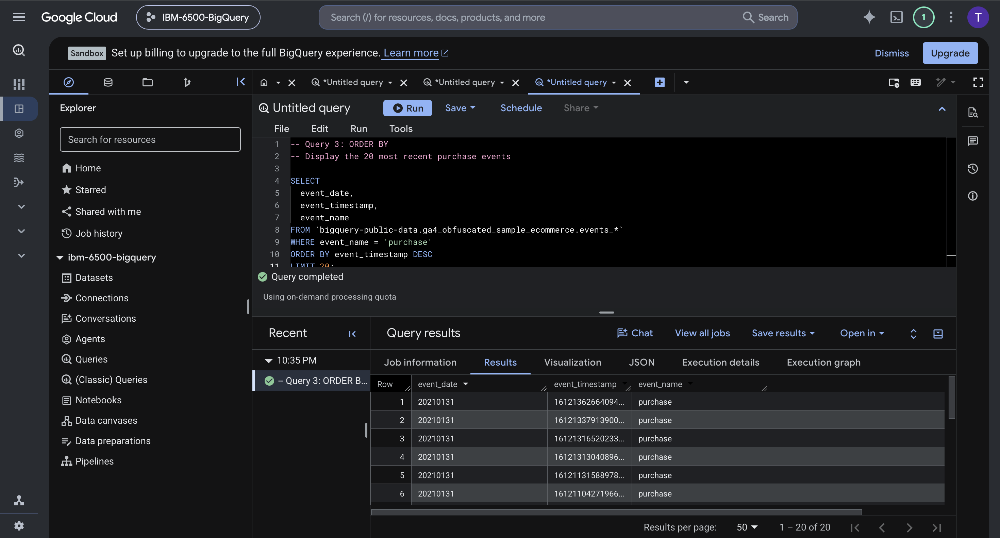
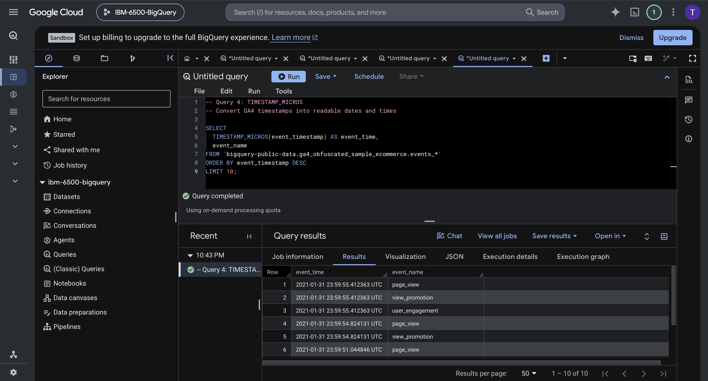
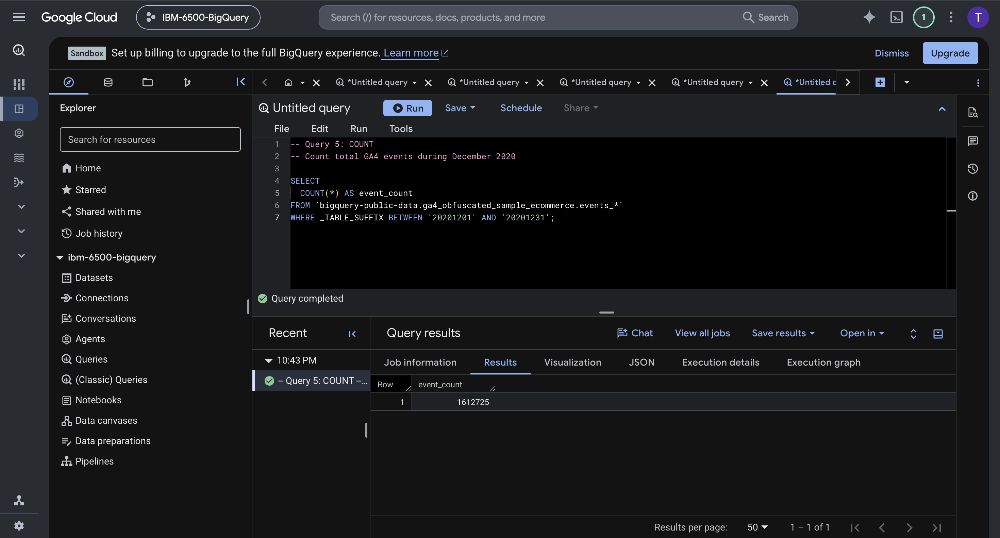
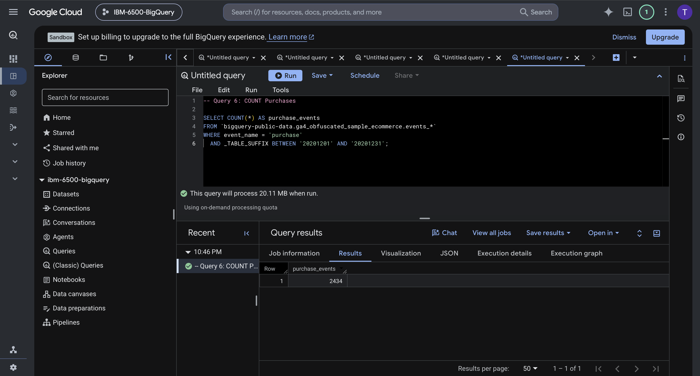
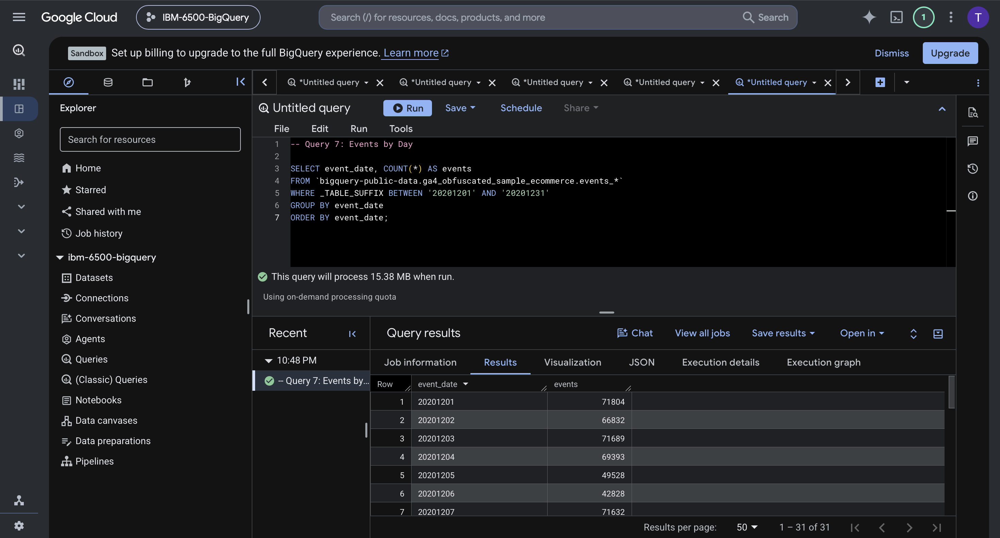
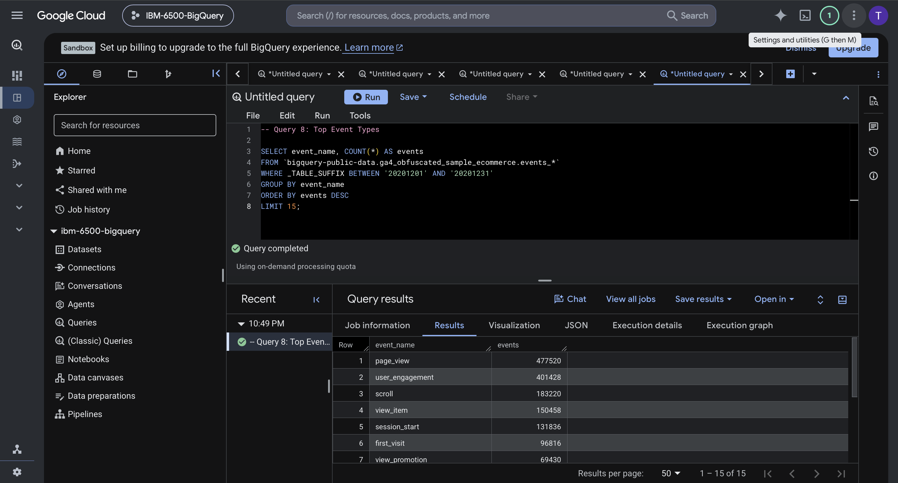
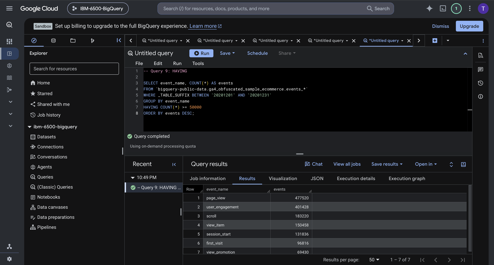
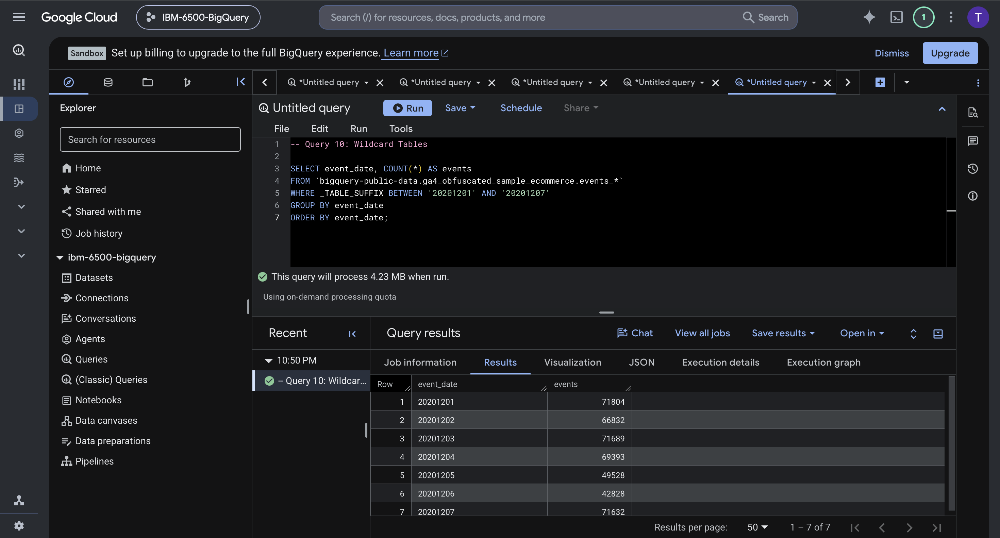

# Introduction

This report documents ten SQL queries completed in Google BigQuery using Google's public GA4 e-commerce sample dataset.

The purpose of this assignment is to practice fundamental SQL concepts and understand how they can be applied to digital marketing analytics.

Each section includes the SQL query, an explanation of its purpose, and a screenshot of the results obtained in BigQuery.

## Data Source

**Dataset:** Google Analytics 4 Obfuscated Sample E-Commerce Data

**Platform:** Google BigQuery

**Source Table:** `bigquery-public-data.ga4_obfuscated_sample_ecommerce.events_*`

The dataset contains website interaction events, including page views, purchases, and other customer activities.

The queries demonstrate filtering, sorting, aggregation, grouping, and working with GA4 daily event tables.

# SQL Queries and Results

## Query 1: SELECT / FROM / LIMIT

**Purpose:** Retrieve 20 events from the GA4 e-commerce dataset.

``` sql
-- Query 1: SELECT / FROM / LIMIT

SELECT
  event_date,
  event_name
FROM `bigquery-public-data.ga4_obfuscated_sample_ecommerce.events_*`
LIMIT 20;
```

**Explanation:**

The `SELECT` statement specifies which columns to retrieve, while `FROM` identifies the dataset. `LIMIT 20` restricts the output to 20 rows.

This query provides a basic overview of the event dates and event types recorded in GA4.

**Query Results:**



## Query 2: WHERE

**Purpose:** Display 50 purchase events from the GA4 dataset.

``` sql
-- Query 2: WHERE

SELECT
  event_date,
  event_name,
  user_pseudo_id
FROM `bigquery-public-data.ga4_obfuscated_sample_ecommerce.events_*`
WHERE event_name = 'purchase'
LIMIT 50;
```

**Explanation:**

The `WHERE` clause filters the dataset to include only events classified as purchases.

This allows marketers to focus on purchase activity rather than examining every website interaction.

**Query Results:**



## Query 3: ORDER BY

**Purpose:** Display the 20 most recent purchase events.

``` sql
-- Query 3: ORDER BY

SELECT
  event_date,
  event_timestamp,
  event_name
FROM `bigquery-public-data.ga4_obfuscated_sample_ecommerce.events_*`
WHERE event_name = 'purchase'
ORDER BY event_timestamp DESC
LIMIT 20;
```

**Explanation:**

The `ORDER BY` clause sorts purchase events by their timestamps in descending order.

This places the most recent purchases at the top of the results, helping analysts examine recent customer activity.

**Query Results:**



## Query 4: TIMESTAMP_MICROS

**Purpose:** Convert GA4 timestamps into readable dates and times.

``` sql
-- Query 4: TIMESTAMP_MICROS

SELECT
  TIMESTAMP_MICROS(event_timestamp) AS event_time,
  event_name
FROM `bigquery-public-data.ga4_obfuscated_sample_ecommerce.events_*`
ORDER BY event_timestamp DESC
LIMIT 10;
```

**Explanation:**

GA4 stores event timestamps in microseconds. The `TIMESTAMP_MICROS()` function converts these values into readable timestamps.

This makes it easier to understand when website interactions occurred.

**Query Results:**



## Query 5: COUNT Total Events

**Purpose:** Count all GA4 events recorded during December 2020.

``` sql
-- Query 5: COUNT Total Events

SELECT
  COUNT(*) AS event_count
FROM `bigquery-public-data.ga4_obfuscated_sample_ecommerce.events_*`
WHERE _TABLE_SUFFIX BETWEEN '20201201' AND '20201231';
```

**Explanation:**

The `COUNT(*)` function calculates the total number of events recorded during the selected period.

The `_TABLE_SUFFIX` condition limits the query to daily event tables from December 1 through December 31, 2020.

This helps analysts measure overall website activity during a specific period.

**Query Results:**



## Query 6: COUNT Purchases

**Purpose:** Count purchase events recorded during December 2020.

```sql
-- Query 6: COUNT Purchases

SELECT COUNT(*) AS purchase_events
FROM `bigquery-public-data.ga4_obfuscated_sample_ecommerce.events_*`
WHERE event_name = 'purchase'
  AND _TABLE_SUFFIX BETWEEN '20201201' AND '20201231';
```

**Explanation:**

This query uses `COUNT(*)` to calculate the number of purchase events during December 2020.

The `WHERE` clause selects only purchase events, while `_TABLE_SUFFIX` restricts the analysis to the specified date range.

This helps marketers measure purchase activity during a particular period.

**Query Results:**



## Query 7: GROUP BY Events by Day

**Purpose:** Count the number of GA4 events recorded each day during December 2020.

```sql
-- Query 7: Events by Day

SELECT event_date, COUNT(*) AS events
FROM `bigquery-public-data.ga4_obfuscated_sample_ecommerce.events_*`
WHERE _TABLE_SUFFIX BETWEEN '20201201' AND '20201231'
GROUP BY event_date
ORDER BY event_date;
```

**Explanation:**

The `GROUP BY` clause organizes events by date, while `COUNT(*)` calculates the number of events recorded each day.

The results are sorted chronologically using `ORDER BY`.

This allows marketers to identify changes in website activity throughout the month.

**Query Results:**



## Query 8: GROUP BY Top Event Types

**Purpose:** Identify the 15 most frequently recorded GA4 event types during December 2020.

```sql
-- Query 8: Top Event Types

SELECT event_name, COUNT(*) AS events
FROM `bigquery-public-data.ga4_obfuscated_sample_ecommerce.events_*`
WHERE _TABLE_SUFFIX BETWEEN '20201201' AND '20201231'
GROUP BY event_name
ORDER BY events DESC
LIMIT 15;
```

**Explanation:**

This query groups website interactions by event type and counts how frequently each event occurred.

`ORDER BY events DESC` sorts the results from most frequent to least frequent, while `LIMIT 15` displays the top 15 event types.

This helps marketers understand which customer interactions occur most often.

**Query Results:**



## Query 9: HAVING

**Purpose:** Identify event types with at least 50,000 recorded events during December 2020.

```sql
-- Query 9: HAVING

SELECT event_name, COUNT(*) AS events
FROM `bigquery-public-data.ga4_obfuscated_sample_ecommerce.events_*`
WHERE _TABLE_SUFFIX BETWEEN '20201201' AND '20201231'
GROUP BY event_name
HAVING COUNT(*) >= 50000
ORDER BY events DESC;
```

**Explanation:**

The `HAVING` clause filters results after they have been grouped and aggregated.

Unlike `WHERE`, which filters individual rows, `HAVING` filters aggregated groups.

This query identifies event types with at least 50,000 occurrences, helping analysts focus on high-volume website interactions.

**Query Results:**



## Query 10: Wildcard Tables

**Purpose:** Count daily GA4 events from December 1 through December 7, 2020.

```sql
-- Query 10: Wildcard Tables

SELECT event_date, COUNT(*) AS events
FROM `bigquery-public-data.ga4_obfuscated_sample_ecommerce.events_*`
WHERE _TABLE_SUFFIX BETWEEN '20201201' AND '20201207'
GROUP BY event_date
ORDER BY event_date;
```

**Explanation:**

The `events_*` wildcard allows BigQuery to query multiple daily GA4 event tables.

The `_TABLE_SUFFIX` condition limits the query to December 1–7, 2020, reducing the amount of data scanned.

Grouping by `event_date` produces daily event totals, which can help marketers monitor website activity over time.

**Query Results:**



# Conclusion

This assignment helped me understand how SQL can be used to retrieve, filter, organize, and summarize Google Analytics 4 data.

I practiced using `SELECT`, `WHERE`, `ORDER BY`, `COUNT`, `GROUP BY`, and `HAVING`, along with timestamp conversion and wildcard tables.

One important lesson was understanding how SQL can transform large datasets into useful marketing insights. For example, counting purchase events and identifying frequently occurring event types can help businesses evaluate website activity and customer engagement.

These skills will be useful for future marketing analytics projects involving Google BigQuery and GA4.

# Published Project Links

## GitHub Pages

[View My BigQuery SQL Lecture 1 Report](https://tarana7.github.io/bigquery-lecture-1/)

## GitHub Repository

[View My BigQuery Lecture 1 GitHub Repository](https://github.com/tarana7/bigquery-lecture-1)